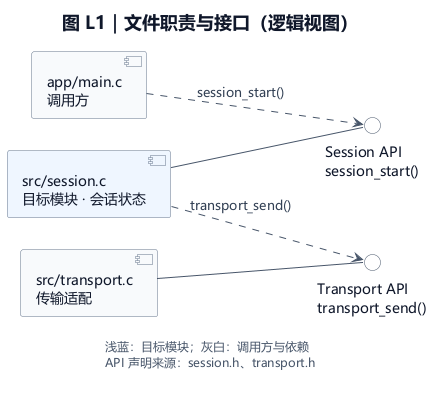
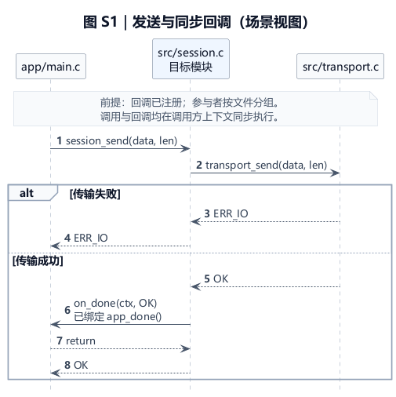

# c-code-design-doc

面向 C 项目的源码学习 Skill：按文件识别模块，将指定源码或调用链整理成有证据的中文 Markdown 设计文档，包含接口契约、模块交互、4+1 视图与 PlantUML 图代码。

适用于具备文件读取、搜索与写入能力的 Agent，采用通用 `SKILL.md` 格式。面向 GLM 5.2 和改造版 OpenCode 使用；尚未在用户的具体环境中实测。

## 下载与安装

- [下载完整技能包](c-code-design-doc.zip)
- [中文使用说明](docs/使用说明.md)
- [查看技能指令](c-code-design-doc/SKILL.md)

将 `c-code-design-doc/` 整个目录复制到目标项目的 `.opencode/skills/` 下，保留 `assets/` 和 `references/`。如果使用 ZIP，解压后复制其中的同名技能目录。

```text
你的项目/.opencode/skills/c-code-design-doc/SKILL.md
```

## 使用示例

替换下面的演示文件名和入口：

```text
请加载并执行 c-code-design-doc 技能。
分析 src/foo.c 和 include/foo.h，必要时追踪直接调用方与依赖。
重点解释初始化、一次请求处理、回调、错误传播和资源释放。
输出到 docs/learning/foo-design.md。
```

改造版若无法自动发现技能，可以直接要求 Agent 读取技能目录中的 `SKILL.md`，再按其要求读取文档模板、建模规范和视觉规范。

## 内容与图示质量

- 用仓库相对文件路径识别模块，区分头文件声明、运行调用、构建输入和回调绑定。
- 关键结论记录源码定位，区分事实、推断与未知；不为补齐视图虚构线程、硬件或部署拓扑。
- 覆盖逻辑、开发、进程、物理与场景五种视角，重点解释接口、执行上下文、资源有效期与错误传播。
- 默认采用白底、蓝灰配色、统一中文无衬线字体、清晰的层级与留白；图代码独立保存于 Markdown。
- 图的语义和外观分别验收，检查乱码、裁切、遮挡、连线端点、标签和正常尺寸下的可读性。

详见 [建模与绘图规范](c-code-design-doc/references/diagram-guide.md)、[专业工程图视觉规范](c-code-design-doc/references/visual-style.md)。

## 样式预览

下图使用虚构模块，仅演示建模与视觉风格。正式学习文档保留 PlantUML 代码；这里附图片便于在 GitHub 查看。





两张图的完整代码见 [专业图示样例](docs/专业图示样例.md)。

## 渲染与验证

使用支持 PlantUML 的 Markdown 查看器渲染图代码。免费浏览器扩展的安装步骤及兼容性说明见中文使用说明；不同引擎可能忽略部分样式或产生不同布局。

技能格式与资源链接已检查；七类图例已使用 PlantUML 1.2025.0 渲染并查看。另以小型 C 样例独立试跑，核查条件编译、同名文件、同步回调以及函数返回码与回调结果的区别；该样例的三张图也成功渲染。没有实际编译或运行样例 C 程序，未实测用户代码库、GLM 5.2、改造版 OpenCode 或浏览器扩展界面。
