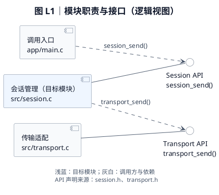
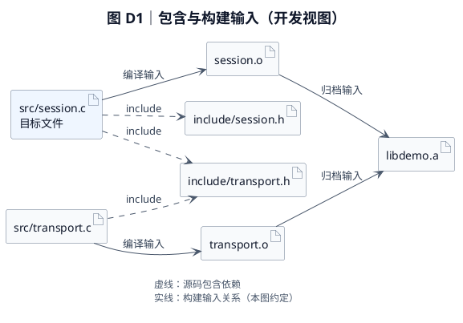
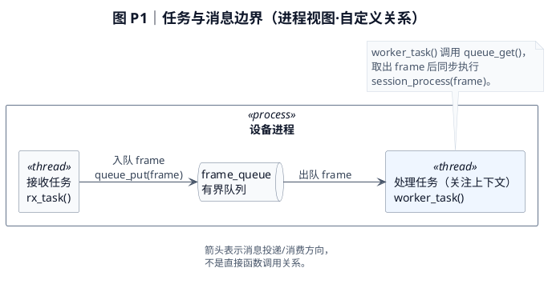
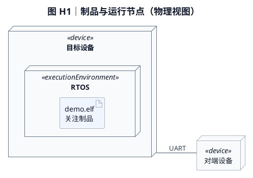
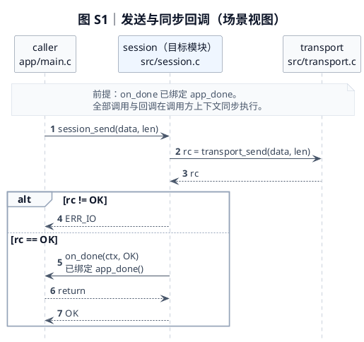
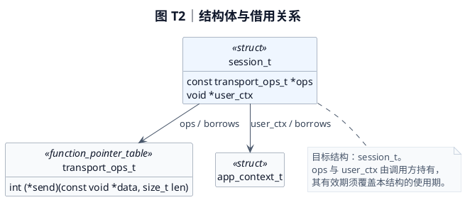

# PlantUML 建模与绘图规范

用于“从 C 源码学习设计”的文档。目标是忠实表达责任、边界、接口和行为，读者能顺着图回到源码。

绘图时同时执行 [专业工程图视觉规范](visual-style.md)，将统一基础样式内嵌到每个独立图块，并按其中的通过条件验收。

## 选择图型与信息层次

- **上下文**：目标文件与直接调用方/依赖，先让读者知道模块位于哪里。
- **逻辑**：组件/接口图表达职责分工；C 的结构体、枚举和函数指针表可以在类图中标注 `<<struct>>`、`<<enum>>`、`<<function_pointer_table>>`。这只是数据建模记法，不表示 C 有类方法或继承。
- **开发**：包、文件/制品与依赖图，说明源码组织、包含与构建；构建图中的转换箭头明确标为“编译输入”“链接输入”，不冒充 UML 标准关系。
- **进程**：带执行上下文的交互图、活动图或上下文关系图。线程/任务与文件是不同维度，同一个文件可以在多个上下文执行。
- **物理**：部署图展示节点、执行环境与制品；节点需要实际配置或代码支持，产物被编译出来不代表已经部署到某设备。
- **场景**：时序图表达具体请求和分支；用例图仅在多个外部角色及目标确实需要归纳时增加。
- **状态**：只有枚举、分支、赋值及生命周期支持真实状态机时才画。初始化成功不一定意味着存在名为 READY 的状态。

不强制每类图各一张。可简化很小的模块，但五个视图的解释必须覆盖；证据不足时说明，不补造图。

## 专业图示的约束

1. **单图回答一个问题**。不要把源码包含、运行调用、线程调度和物理网络混成一个总图。
2. **层次一致**。同层参与者使用相近粒度；外部依赖、目标模块和环境边界用分组或构造型区分。逻辑组件上的文件名是可追溯标识，不表示文件独立部署。
3. **每条关键边可回溯**。图后附证据范围，必要时用小表列出“关系 → E 编号”。代码注释里的证据不能替代读者可见的图后说明。
4. **使用实际名称**。节点标签保留文件名，边写真实函数/事件/接口；不要只写“调用”“处理”“数据”。过长签名放接口表，图中保留决定语义的参数。
5. **方向有语义**。依赖从使用方指向被依赖方，数据流按实际方向，时序按真实先后。接口提供者与使用者不能画反。UML interface 节点命名为操作契约（例如 Session API），声明来源另标 `session.h`；头文件制品本身放在开发视图，不把任意头文件自动当作一个 UML 接口。
6. **未知显式表达**。无法解析的回调可画为“未解析回调目标”，标明 `<<unresolved>>` 并附绑定缺口。示意性分组要注明，不画成已确认的架构实体。
7. **克制布局**。通常单图约 5–9 个主要元素最易读；复杂图按场景或边界拆分，此数量只是阅读建议。结构图可横向或纵向，时序图按时间向下展开。图过宽时先缩短接口标签、把完整签名移到接口表，再调整方向或拆图；不要以缩小字号掩盖拥挤。只使用有限颜色。
8. **共用命名**。同一文件、接口、队列和状态在全部图中保持一致名称。跨图可用不同别名，但同一代码块内别名必须唯一。

## 通用语法与兼容性

每个图使用 `plantuml` 围栏，包含 `@startuml` / `@enduml`；不嵌套 Markdown 围栏。图块独立渲染，不依赖其他图块定义。

使用基础 PlantUML 语法，显式声明节点和参与者。标签加双引号，标识符用简单 ASCII 别名，如 `M_SESSION`；显示标签中用 `\n` 换行。保持中文说明，文件名/符号使用原名。

开发图的源码包含边可写 `include`，在图例说明其对应 `#include`；源码原文保留在 C 代码块。避免将带格式标记的源码片段直接塞进关系标签后，未经预览就认定显示结果与原文一致。

每个图块采用 visual-style.md 的白底蓝灰样式；按图型选择方向、`hide footbox` 和 `autonumber`，不照搬无关图型设置。最终以语义和视觉两项验收结果为准。

不使用远程 `!include`、`!includeurl`、外部图片、C4 宏库、需要插件的图标或未知主题。这样图代码更容易在不同免费渲染器中使用；仍不能保证任意插件支持全部语法。

## UML 语义与工程约定的边界

PlantUML 能画出的形状和箭头不都属于标准 UML。组件、接口、类、时序、状态和部署图按 UML 对应语义使用；构建输入图、队列数据流图可以作为 4+1 的辅助表达，但须在图题或图后写明“自定义关系”，并给图例。4+1 不要求所有视图都采用 UML。

- 逻辑组件表示有边界的职责与契约；文件路径是实现映射。不要把目录布局复制成逻辑架构，也不要默认每个 `.c` 都是独立组件。
- 时序生命线表示本场景中的运行时参与者。用“角色名 + 来源文件”标识 C 模块的执行角色；它不是源文件对象，也不意味着独立线程。不同会话实例或线程影响语义时必须分开；只有模块级总览才可合并，并注明抽象范围。
- `<<struct>>`、`<<function_pointer_table>>`、`<<thread>>`、`<<process>>`、`<<unresolved>>` 在本技能中是解释 C 代码的自定义标记，须在图后说明含义；不宣称它们属于 UML 标准 Profile。
- 头文件用制品表达；声明在其中的一组操作契约才可用接口表达。组合关系的实心菱形位于整体端，只有独占包含和生命周期约束有证据才使用；共享/借用指针用普通引用关系。
- 部署图优先将制品嵌套在节点/执行环境内表示部署，将节点间通信路径标出介质或协议；不要把目录包含画成部署。类型级拓扑与运行实例需区分，实际实例名称和数量必须有证据。

## 常用关系

| 图型 | 表达 | 含义/注意点 |
|---|---|---|
| 组件/开发 | `A ..> B : ...` | UML 依赖从使用方指向被依赖方；不能用它同时表示反向的构建输入流 |
| 开发辅助图 | `source --> output : 编译输入` | 自定义构建输入方向；图例必须与 UML 依赖区分 |
| 组件 | `Provider -- I` | I 必须显式声明为 `interface` 圆形节点；实线连接表示提供接口，`Consumer ..> I` 表示使用 |
| 数据结构 | `A --> B : pointer / borrows` | 导航/引用；指针不等于拥有 |
| 数据结构 | `A *-- B` | 仅在独占包含及生命周期约束有证据时用组合 |
| 时序 | `A -> B : function()` | 实线、实心箭头：同步调用；不能把变量赋值当作自调用 |
| 时序 | `A --> B : result` | 返回；不是异步消息 |
| 时序 | `A ->> B : event` | 实线、开放箭头：已确认的异步消息；队列 API 调用自身仍可能同步 |
| 状态 | `S1 --> S2 : event [guard] / action` | 事件、守卫条件和动作必须对应实际实现 |

箭头风格按各图型的语法解释，不能把时序图中的 `-->` 机械地用于其他图型并赋予“返回”含义。

### 时序图细则

- 按主链从左到右排列参与者，显式声明每个参与者及其文件来源。
- 生命线按运行时角色命名并附文件来源，例如 `session\nsrc/session.c`；在图后说明角色对应哪个实例、共享模块或执行入口。执行线程另用 `box` 或 note 说明。不能从参与者数量推导线程数量。
- 用 `alt/else` 标真实分支，用 `opt` 标可选行为，用 `loop` 标真实循环；并发证据存在才用 `par`。分支条件尽量写源码中的布尔条件（如 `rc != OK`），并检查后续消息是否对所有能到达它的分支都成立。
- 真实函数指针调用要标出指针成员和已确认目标；直接在当前调用栈执行的回调仍使用同步箭头。
- 调用消息写操作名和关键输入，返回写关键结果/错误。状态赋值和参数检查用附着于生命线的 note；只有真实的函数自调用才画自身消息。不要画无意义的每层返回，也不能漏掉改变结果的错误转换。
- 说明回调在被调用函数返回之前还是之后发生；异步队列的入队函数返回和消费者开始处理是两个事件，不能把函数返回箭头当作消费消息。
- 激活条不是装饰；使用时配对平衡。若分支让激活难以准确表达，可以省略激活条，不能为视觉效果伪造执行区间。
- “成功示例调用链”不能隐藏初始化前提或配置分支；错误路径应表现已经分配资源的释放和最终状态。

## 完整示例

以下全部是**虚构的建模与样式演示**，不存在对应仓库证据。L1 与 S1 使用同一发送接口演示；其他示例各自独立，不共同描述一个系统。不得原样混入真实文档；使用时替换所有文件、符号、关系和说明。真实文档中每图后要有依据，并完成跨视图映射。

### 逻辑视图：文件与接口



L1 仅展开发送接口的使用与提供关系，文件名标明实现来源；同步完成回调见 S1。接口声明分别来自 `session.h` 与 `transport.h`。

### 开发视图：包含与构建输入



D1 的实线是本图约定的构建输入流，不是 UML 依赖箭头；本例仅描述库的构建，不对应 H1 中的固件制品。

### 进程视图：有证据时才使用任务与队列



P1 是执行上下文与数据流辅助图；`process` / `thread` 为本图的进程/任务标签，`queue` 形状表示队列。它不冒充标准 UML 活动图，连线也不表示函数调用或调度先后。

### 物理视图：节点、执行环境与制品



H1 展示假定的节点类型及制品部署关系，不表示已经观测到某台实际设备；真实文档必须由部署配置或运行证据支持。

### 场景视图：同步回调与错误传播



S1 的生命线是调用入口、会话模块和传输模块在该场景中的运行时角色，第二行给出实现来源，三者不是三个线程。本演示假定传输只返回 `OK` 或 `ERR_IO`；成功时会话模块才同步调用完成回调，随后返回调用方。

### 状态图：只有源码具备状态机时使用

```plantuml
@startuml
skinparam backgroundColor #FFFFFF
skinparam shadowing false
skinparam defaultFontName "Microsoft YaHei"
skinparam defaultFontSize 14
skinparam defaultFontColor #0F172A
skinparam titleFontColor #0F172A
skinparam titleFontSize 18
skinparam ArrowColor #475569
skinparam ArrowFontColor #334155
skinparam ArrowFontSize 13
skinparam ArrowThickness 1
skinparam NoteBackgroundColor #F8FAFC
skinparam NoteBorderColor #CBD5E1
skinparam NoteFontColor #475569
skinparam NoteFontSize 13
skinparam LegendBackgroundColor #FFFFFF
skinparam LegendBorderColor #FFFFFF
skinparam LegendFontColor #475569
skinparam LegendFontSize 12
hide empty description
skinparam stateBackgroundColor #F8FAFC
skinparam stateBorderColor #64748B
skinparam stateStartColor #334155
skinparam stateEndColor #334155
skinparam nodesep 36
skinparam ranksep 40
title 图 T1｜资源状态与迁移
state "CLOSED" as S_CLOSED
state "READY" as S_READY
state "BUSY" as S_BUSY
[*] -down-> S_CLOSED
S_CLOSED -down-> S_READY : open_ok\n/ 保存句柄
S_READY -down-> S_BUSY : submit [参数有效]\n/ 设置在途标记
S_BUSY --> S_READY : complete\n/ 清除在途标记
S_READY --> S_CLOSED : close\n/ 释放句柄
@enduml
```



T1 假定 `open_ok` 是初始化成功事件，`submit`、`complete`、`close` 是已定义事件；`[参数有效]` 在迁移动作前判断。真实文档须将事件、守卫与动作映射到代码，不能用执行动作之后才知道的结果冒充前置守卫。

### C 数据结构图：引用与所有权分开



T2 中 `struct` 与 `function_pointer_table` 是本图的 C 类型标记。`user_ctx` 指向 `app_context_t` 是本演示的显式假设；真实代码须追踪赋值、转换与使用点，不能仅凭 `void *` 推断目标类型或所有权。

## 验证与取舍

先检查图与源码语义一致，再检查图语法和布局；“能渲染”不能证明内容准确。

本地已有 PlantUML JAR 时，可按现有版本 CLI 检查临时提取的图。例如在支持传统选项的版本中：

```text
java -jar <本地plantuml.jar> -checkonly <临时图目录>
java -jar <本地plantuml.jar> -tsvg <临时图目录>
```

以真实退出状态和输出为准。图形布局可能还依赖 Graphviz 或版本自带的布局能力；缺依赖时不要将失败说成通过，也不把语法检查说成视觉检查。

有预览能力时检查交叉线、遮挡、长标签、中文字体和错误页；没有预览能力则写明未进行视觉检查。最多按实际错误做必要修复，不能以换掉真实关系来换取渲染成功。

语法资料（需要核对时查阅，不是输出依赖）：

- [OMG UML 2.5.1 规范](https://www.omg.org/spec/UML/2.5.1/PDF)：组件与接口见第 10–11 章，状态机第 14 章，交互第 17 章，部署第 19 章。
- [PlantUML 组件图](https://plantuml.com/component-diagram)
- [PlantUML 时序图](https://plantuml.com/sequence-diagram)
- [PlantUML 部署图](https://plantuml.com/deployment-diagram)
- [PlantUML 状态图](https://plantuml.com/state-diagram)
- [PlantUML 类图](https://plantuml.com/class-diagram)
- [4+1 原始论文](https://www.cs.ubc.ca/~gregor/teaching/papers/4%2B1view-architecture.pdf)
