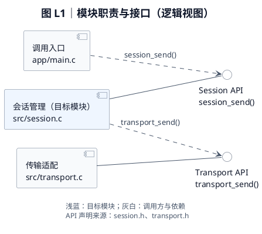
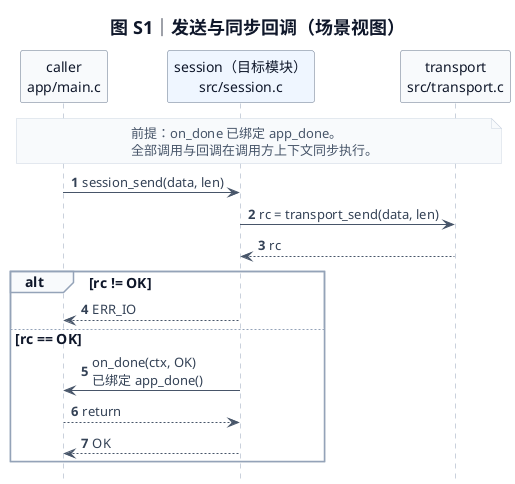

# 专业工程图样式预览

以下是虚构 C 模块的建模和视觉示例，不描述你的实际代码库。正式学习文档只需保存 PlantUML 图代码。

## 逻辑视图：职责、接口与实现来源

本图仅展示发送接口；回调行为见下一张时序图。文件名用于定位实现，不代表独立部署单元。

## 场景视图：同步调用、回调与错误传播

生命线表示运行时角色，第二行是实现文件。三个角色在同一调用方上下文同步执行，不表示三个线程。此虚构场景假定传输只返回 `OK` 或 `ERR_IO`，成功时才调用已绑定的回调。

